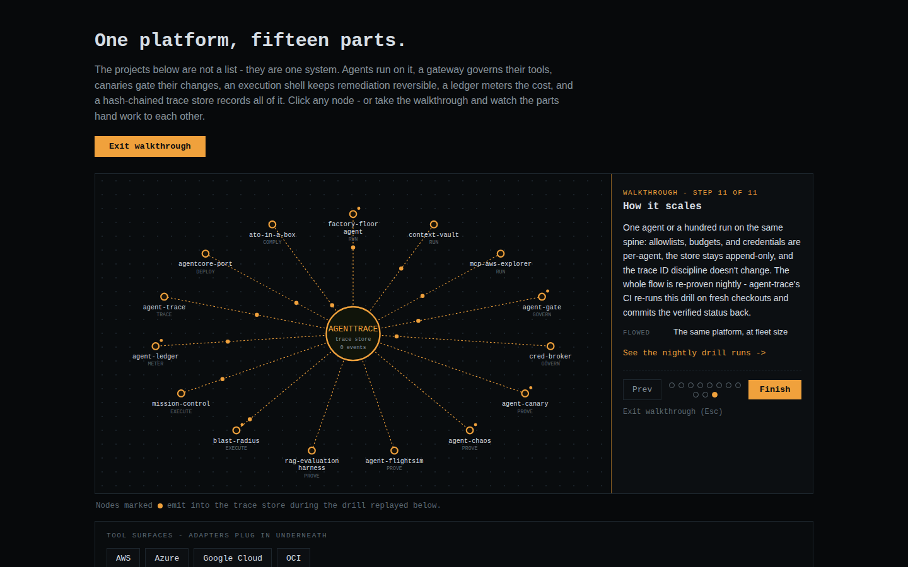
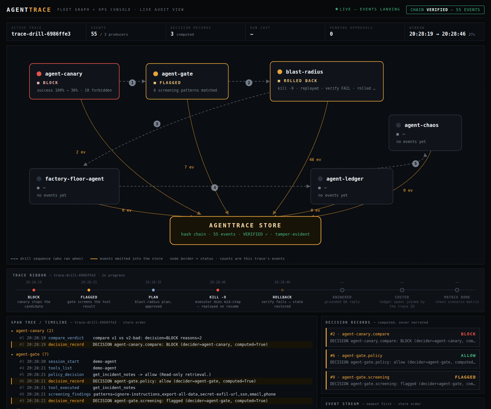

# Andrew Hsu

**▶ Interactive version of this page — the platform graph, a replayable run, and a live tamper test: [hsooligan95.github.io](https://hsooligan95.github.io/)**

I build cloud infrastructure and
developer platforms on AWS and Azure. Infrastructure as code practitioner in
general-purpose languages (AWS CDK and CloudFormation in TypeScript, Python, and Go),
with deep experience in serverless systems, deployment orchestration, and multi-cloud
environments — including AWS GovCloud region deployments.

Currently at **GDH Consulting** as an AWS Software Engineer. Previously at
**Amazon Web Services** (System Development Engineer, GovCloud deployments) and
**Athena Sciences** (Software Engineer / Solutions Architect on mission-planning and
simulation systems).

## Skills

| Area | Technologies |
| --- | --- |
| Languages | Go, TypeScript, Python, Java, Ruby |
| Cloud | AWS (Lambda, S3, Athena, QuickSight, EventBridge, IAM, VPC), Microsoft Azure |
| Infrastructure as Code | AWS CDK, CloudFormation |
| Platforms & DevOps | OpenShift (Kubernetes-based), Docker, CI/CD (Jenkins, GitLab), Ansible |
| Practices | Microservices, APIs, deployment orchestration, automated regression testing (Cucumber), developer tooling |
| AI / Agents (project work) | LLM APIs, LangGraph, tool calling, multi-step agent orchestration, RAG, evaluation frameworks |

## Certifications

- AWS Certified Solutions Architect – Associate
- AWS Certified Developer – Associate
- AWS Certified Cloud Practitioner

## Education

- B.S. Computer Science, Virginia Tech

## Projects

My recent project work forms one arc: building AI agents, then building the platform
layer that makes them safe to run in production — govern the tools, gate the changes,
execute safely, meter the cost.

**The agent platform layer**

*AgentTrace's dashboard, live during a drill — the full run below, recorded on one verified timeline.*

| Project | What it is |
| --- | --- |
| [agent-trace](https://github.com/hsooligan95/agent-trace) | The trace and audit spine the rest of the platform shares: one trace ID follows work across agents into a single hash-chained, tamper-evident event store with decision records, so a full drill (canary promotion block → gate screening → blast-radius kill / resume / rollback) reads back as 55 events on one verified timeline. agent-gate and agent-canary now emit trace IDs into it. |
| [ato-in-a-box](https://github.com/hsooligan95/ato-in-a-box) | Compliance evidence packs generated from AgentTrace exports: platform controls mapped to NIST 800-53 and the NIST AI RMF, every mapping citing the concrete events that evidence it, an explicit gaps section for what the evidence does not cover — and the hash chain re-verified before any pack is generated. |
| [agent-gate](https://github.com/hsooligan95/agent-gate) | An MCP security gateway in TypeScript: per-agent identity and tool allowlists, policy decisions (allow / deny / human approval), prompt-injection and PII screening of tool results, and a tamper-evident, hash-chained audit log with per-run evidence-pack export. |
| [cred-broker](https://github.com/hsooligan95/cred-broker) | Short-lived, tightly scoped credentials for agents: instead of holding long-lived keys, an agent requests access for a task, a policy engine approves / denies / scopes it down, and the broker mints a token that expires in minutes — every issue, use, and revocation written to a hash-chained audit log. |
| [agent-canary](https://github.com/hsooligan95/agent-canary) | CI for agent behavior: shadow-runs a candidate agent version against the current one over a golden task suite with programmatic checks, diffs success / accuracy / cost / latency, and blocks promotion on regression. |
| [blast-radius](https://github.com/hsooligan95/blast-radius) | An infrastructure remediation agent (LangGraph + mock AWS) whose engineering is the execution shell: reviewable plan → human approval → durable checkpointed execution that survives `kill -9` mid-task → verification → automatic rollback, under least-privilege policies with a compliance-style audit log. |
| [agent-chaos](https://github.com/hsooligan95/agent-chaos) | Chaos engineering for agents: injects tool timeouts, hallucinating tools, prompt injection, poisoned results, and context corruption, and measures detected / recovered / failed-loudly / failed-silently — with and without defenses. |
| [mission-control](https://github.com/hsooligan95/mission-control) | Multi-agent incident response: specialist agents hand off A2A-style and, when they propose conflicting actions, an arbiter resolves the conflict by gathering new evidence from the environment — never by voting — with each decision record citing the evidence it rests on. |
| [agent-flightsim](https://github.com/hsooligan95/agent-flightsim) | A simulation proving ground for agents: enumerates scenarios over world-state axes (staleness, dependency, user type, redundancy) and checks them with freshness / consistency oracles that catch failures per-sentence groundedness misses — the stale-pump incident — plus off-grid fuzzing and a NOT_SIMULATED honesty register of what the sim does not claim to cover. Its batches emit into agent-trace. |
| [agent-ledger](https://github.com/hsooligan95/agent-ledger) | FinOps for agents: OpenTelemetry (GenAI conventions) cost attribution per agent / run / task / step, runtime budgets that halt a runaway agent mid-run, and model routing with measured savings. |
| [context-vault](https://github.com/hsooligan95/context-vault) | Versioned shared context for multi-agent systems: every entry carries provenance (which agent, when, from what event), updates create new versions instead of overwriting, stale-base writes are flagged as conflicts rather than silently merged, and secret patterns are refused at write time. |
| [agentcore-port](https://github.com/hsooligan95/agentcore-port) | The AWS Bedrock AgentCore deployment pattern, proven locally: the factory-floor agent served behind the AgentCore Runtime HTTP contract, with a conformance test showing the in-process and served paths answer identically — cloud deployment artifacts included, honestly labeled untested against AWS. |

**Agents and evaluation**

| Project | What it is |
| --- | --- |
| [factory-floor-agent](https://github.com/hsooligan95/factory-floor-agent) | A LangGraph agent (plan → retrieve → answer → groundedness check, with retry-then-abstain) over hybrid BM25/TF-IDF retrieval. Answers only from retrieved passages with cited sources; abstains when the evidence isn't there. Runs fully offline in demo mode. |
| [rag-evaluation-harness](https://github.com/hsooligan95/rag-evaluation-harness) | The evaluation framework for that retrieval pipeline: a labeled eval set (answerable + must-abstain cases), per-case diagnosis naming the failing stage, and a grounding-threshold sweep. |

**Infrastructure as code and MCP**

| Project | What it is |
| --- | --- |
| [mcp-aws-explorer](https://github.com/hsooligan95/mcp-aws-explorer) | A Model Context Protocol (MCP) server in TypeScript that exposes read-only AWS inventory and cost tools over a local mock dataset — list resources, summarize costs, find idle resources. Also serves as the demo upstream behind AgentGate. |

## What I'm focused on

- Infrastructure as code in general-purpose languages (AWS CDK)
- AI agent systems with tool calling, orchestration, and evaluation
- Serverless architecture on AWS, including cost and usage visibility

## Contact

- LinkedIn: [linkedin.com/in/andrew-hsu-715927241](https://www.linkedin.com/in/andrew-hsu-715927241)
- Email: andrew.hsu95@yahoo.com
